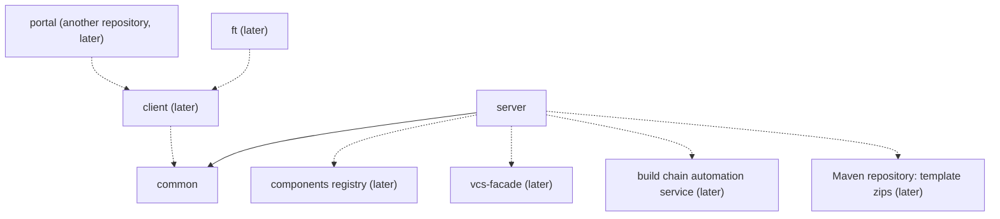

# Architecture

The component provisioning service serves the provisioning-configuration catalogue: for each kind of component, which repository templates, build chain options and extra stages it gets when it is provisioned. Later it will also carry out the provisioning. This page says which module owns what and how a request flows. Class-level detail is left to the code.

## Modules



An arrow means "depends on". Dashed parts do not exist yet.

| Module | Owns | May depend on | Must never depend on |
| --- | --- | --- | --- |
| `common` | The wire contract: the catalogue types, the provisioning request, status and resolved-configuration types, and the error envelope | nothing | anything |
| `server` | The Spring Boot service | `common`, later the clients of the services it calls | `client`, `ft` |
| `client` (later) | The Feign client for the API | `common` | `server` |
| `ft` (later) | The functional tests, run against a started server | `client` | `server` |

Why each rule:

- **`common` depends on nothing**, because every caller imports it: whatever it depends on, every caller pulls in.
- **`server` never sees `client` or `ft`.** The service does not call itself and knows nothing about who calls it.
- **`client` never sees `server`.** A caller needs the HTTP contract, not Spring Boot and Tomcat.
- **`ft` talks to the service over HTTP** through `client`, like any other caller.

Gradle enforces the dependency rules: a module cannot import what its build file does not declare. This page holds the reasons.

### What `common` holds

`common` holds only types that cross the wire: what callers send and receive. Types that never leave the service (what it reads from other systems, parsed markers, template descriptors, internal plans) live in `server`.

The types sit in `org.octopusden.octopus.provisioning.common.dto`, in sub-packages by API area:

| Package | For |
| --- | --- |
| `dto.configuration` | The catalogue: `ProvisioningConfiguration` and its parts (`Origin`, `RepositoryEntry`, `TemplateRef`, `BuildChain`, `ExtraStage`) |
| `dto.resolved` | The answer to "which configuration serves this origin": `ResolvedConfiguration`, with each field marked fixed or open |
| `dto.provisioning` | Provisioning: the request a caller sends (`ProvisioningRequest`) and the status it gets back (`ProvisioningStatus`, `ProvisioningState`) |
| `dto.error` | The error envelope: `ApiErrorResponse`, `ApiError` |

## Request flow

The service declares these endpoints:

| Endpoint | Answers |
| --- | --- |
| `GET /rest/api/1/configurations` | The catalogue, as configured |
| `GET /rest/api/1/configurations?profile=…` or `?componentTemplate=…[&componentTemplateVersion=…]`, with `url=…` repeatable | The `ResolvedConfiguration` for that origin: each field fixed or open, and the repository entry that matched each URL. **501 until implemented** |
| `GET /rest/api/1/components/{id}/provisioning` | The `ProvisioningStatus`. **501 until implemented** |
| `POST /rest/api/1/components/{id}/provisioning` | Provisions, or continues after a failure, from a `ProvisioningRequest`; safe to repeat. **501 until implemented** |

`{id}` is the component's id in the components registry. One handler serves `GET .../configurations`: with `profile` or `componentTemplate` it resolves the origin, otherwise it returns the catalogue.

```
caller ── GET /rest/api/1/configurations ──► security library: valid token?
                                               └─► ProvisioningConfigurationController
                                                     └─► ProvisioningConfigurationService
                                                           └─► ComponentProvisioningProperties
                                                                 (bound from Spring Cloud Config)

caller ── /rest/api/1/components/{id}/provisioning ──► security library ──► ProvisioningController
                                                                              └─► ProvisioningService
                                                                                    (throws NotImplementedException → 501)
```

Every endpoint except the actuator and the Swagger UI needs a valid Keycloak token. The shared security library checks it before the controller runs. Any authenticated user may read the catalogue.

Only `common` types cross the wire, in both directions.

Errors become `{"error": {"code", "message"}}` in one `@RestControllerAdvice`, `ExceptionInfoHandler`.

Provisioning itself (later) adds these parts behind a provisioning API:

- **Authorization**: before anything is created, checks that the caller holds the provisioning permission, may edit the component, and targets an allowed project.
- **Configuration Selector**: picks the provisioning configuration by the component's origin, or by an explicit id for a component without one.
- **Repository Initializer**: for a repository that still needs it, downloads the template zip, fills it in and asks vcs-facade to create the repository.
- **Build Chain Initializer**: builds the request for the build chain automation service and calls it.
- **Coordinator**: runs the steps in order, repositories first, then the build chain; stops on a conflict and never rolls a step back. A caller retries by repeating the request.
- **Status Reader**: reads the state of each created resource and interprets the marker the service left on it.

They call, with the caller's token, the components registry; with a technical account (HTTP Basic auth through the gateway, which turns it into a Bearer token), vcs-facade and the build chain automation service; and the Maven repository for the template zips.

## Inside the server

The server's packages are grouped by role, so a new piece has one obvious place:

```
org.octopusden.octopus.provisioning.service
├── controller/      HTTP only: ProvisioningConfigurationController, ProvisioningController, advice/ExceptionInfoHandler
├── service/         the use case: ProvisioningConfigurationService, ProvisioningService, NotImplementedException
│                    (declared but not built yet; ExceptionInfoHandler answers 501)
└── configuration/   properties and wiring: ComponentProvisioningProperties, WebSecurityConfig
```

| Package | May use | Never uses |
| --- | --- | --- |
| `controller` | `service`; only `common` types in and out | `configuration` |
| `service` | `configuration` (the catalogue properties) | `controller` |
| `configuration` | everything, to wire it | — |

Dependencies point one way: `controller → service → configuration`. The `common` catalogue types double as the properties model, so the service returns them without mapping.

What each part does on a request:

- the controller only translates HTTP;
- the service returns the catalogue;
- the properties hold the catalogue as the configuration server provides it.

## Boundaries

- **The catalogue is per-environment configuration.** It is served as written and is not validated yet; adding a kind of component is a configuration change, not a code change.
- **There is no database.** Later, the state of a provisioning is read from markers on the resources the service created.
- **The service never talks to the VCS or the build server directly.** It goes through vcs-facade and the build chain automation service, so their rules stay in one place each.